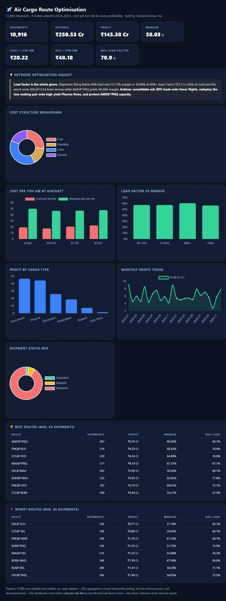

**Live Dashboard:** https://hemantkjha-data.github.io/air-cargo-route-analysis/dashboard/

# ✈️ Air Cargo Route Optimisation Analysis

**Business question:** *Which routes and aircraft make money, which bleed it, and what should the network plan change?*



## ▸ Project Highlights

▸
Built ton-km unit economics for 12,000 shipments across 8 Indian airports — network-wide cost of ₹20.22/ton-km against revenue of ₹48.18/ton-km (58.03% margin).
▸
Decomposed the ₹105.14 Cr cost base into fuel (25.8%), crew (38.8%), ground (18.7%) and handling (16.7%) to locate optimisation levers.
▸
Benchmarked the fleet with SQL: ATR72F runs cheapest at ₹17.68/ton-km while B757F costs ₹22.75/ton-km — 28% more for the same unit of work.
▸
Ranked routes by pooled profit — AMD→PNQ prints 68.36% margin while DEL→CCU delivers the network's weakest economics (37.78%) — and recommended redeploying loss-making capacity onto high-yield Pharma flows.

## 📁 Repo Structure

```
├── data/
│   ├── data.csv          # 12,000 shipment records (synthetic, deterministic)
│   └── data.db           # SQLite database
├── sql/
│   └── queries.sql       # 10 annotated queries incl. window-function route ranking
└── dashboard/
    ├── index.html        # Interactive dashboard (Chart.js)
    ├── agg_data.json
    └── screenshot.jpg
```

## 🚀 How to Run

1. **Dashboard:** open `dashboard/index.html` in any browser.
2. **SQL:** `sqlite3 data/data.db < sql/queries.sql`

## 🔍 Key SQL (aircraft unit economics)

```sql
SELECT aircraft, COUNT(*) shipments,
       ROUND(SUM(total_cost)*1000.0/SUM(distance_km*weight_kg),2) cost_per_ton_km,
       ROUND(SUM(revenue)*1000.0/SUM(distance_km*weight_kg),2) rev_per_ton_km,
       ROUND(AVG(load_factor)*100,1) avg_load_factor
FROM shipments WHERE status='Delivered'
GROUP BY aircraft;
```

*ton-km = distance_km × weight_kg ÷ 1000 — the standard network-carrier unit of work.*

## 💡 Analytical Takeaways

1. **Fleet mix has a cost lever** — turboprops (ATR72F) are 22% cheaper per ton-km than B757F on short sectors; right-sizing equipment to route length matters.
2. **Load factor drives margin** — flights under 60% load earn 56.88% margin vs 60.77% at 90%+; consolidating thin loads onto fewer frequencies is the first move.
3. **Yield by commodity** — Documents and Pharma pay the highest revenue per ton-km; capacity should be protected for them before low-yield Auto Parts.
4. **Route-level P&L discipline** — pooling profit by lane (window-function ranking) exposes exactly which frequencies deserve expansion and which should be cut.

---

*Dataset is synthetic and generated deterministically for portfolio demonstration. All figures are computed from the data via the SQL in `sql/queries.sql`.*

**Built by Hemant Kumar Jha** · Data Analyst · SQL · Python · Dashboards
